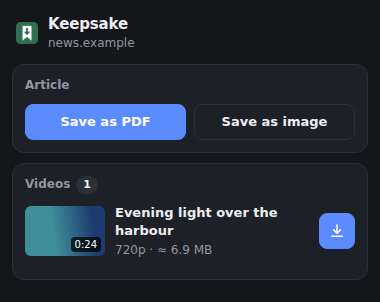
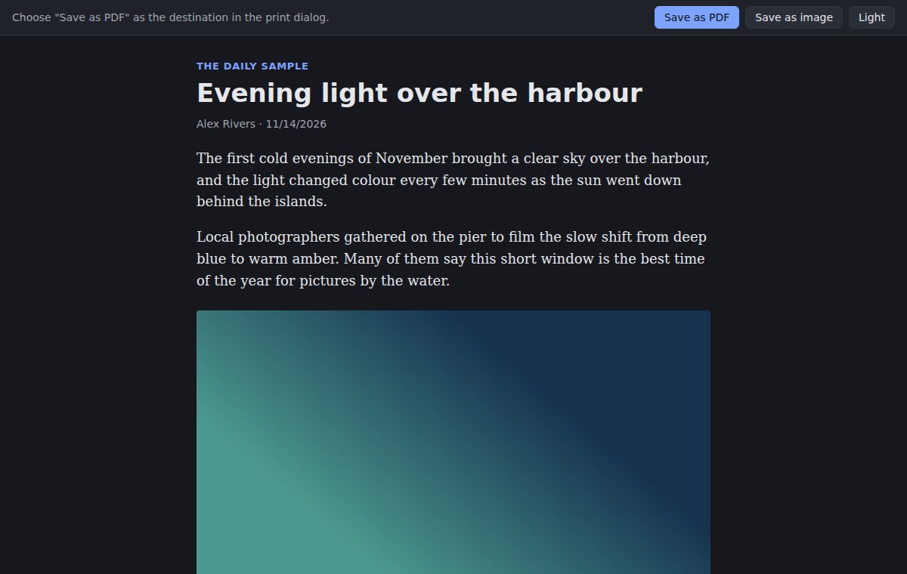

# Keepsake

A small Chrome extension that saves videos and articles from pages you can already open.

It doesn't get around paywalls, logins or DRM. It only saves what your browser already shows you.

## Install

1. Download the zip from [Releases](../../releases) and unzip it
2. Open `chrome://extensions` and turn on Developer mode
3. Click Load unpacked and pick the folder

## Use

Play the video, click the Keepsake icon and press Download. The video is saved like any other download.

For articles press Save as PDF or Save as image. A clean copy of the article opens in a new tab, in a light or dark look. Its Image PDF button saves the pages as pictures, so colours stay exact whatever the print settings are. Phone PDF does the same with pages shaped like a phone screen, which is handy for sharing in a chat app.

## Privacy

Everything happens in your browser. No servers, no tracking, nothing is sent anywhere. More in [PRIVACY.md](PRIVACY.md).

## License

MIT © 2026 Jouni Mikkola. Keep the copyright notice if you share or change it.
